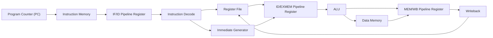
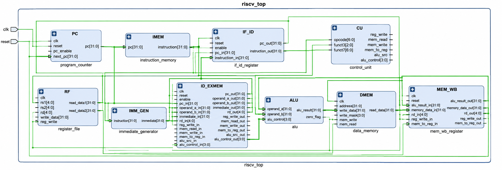
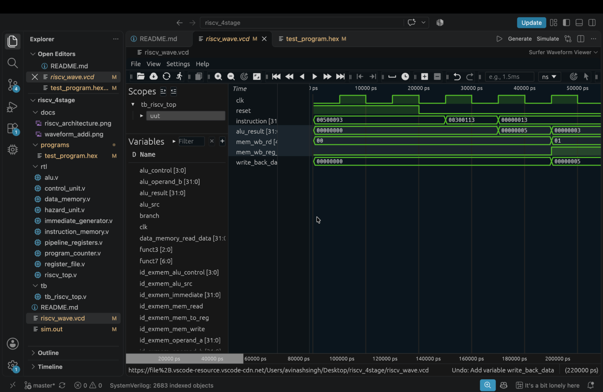
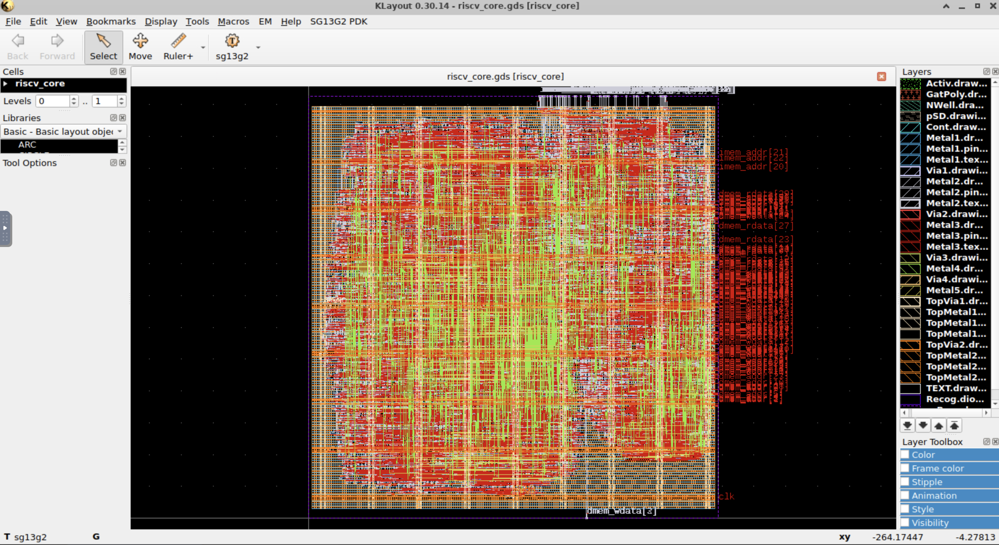

# RISC-V 32-bit 4-Stage Pipelined Processor (RTL-to-GDSII)

## Overview

This project implements a 32-bit RISC-V pipelined processor (`RV32I` subset) in Verilog, verified via self-checking simulation and taken all the way through an automated **RTL-to-GDSII ASIC physical design flow** using **LibreLane / OpenROAD** on the **IHP 130nm (`sg13g2`)** open-source PDK.

The architecture uses a 4-stage pipeline with Execute and Memory operations combined into a single stage, achieving **DRC-clean, LVS-clean, and timing-clean signoff** with 0 violations.

## Architecture



## Pipeline Stages

1. **IF — Instruction Fetch:** The program counter selects an instruction from instruction memory.
2. **ID — Instruction Decode:** The instruction is decoded; register operands, immediate values, and control signals are generated.
3. **EX/MEM — Execute and Memory:** The ALU performs arithmetic and logic operations, while data memory handles load and store instructions.
4. **WB — Writeback:** The ALU result or memory data is written back to the register file.

## Features

- 32-bit RISC-V datapath with 4-stage pipelined architecture
- 32 general-purpose registers (`x0`–`x31`)
- Arithmetic, logic, load, and store operations
- Branch (`BGE`, etc.) and jump (`JAL`, `JALR`) instructions
- Hazard detection, forwarding, and pipeline control
- Self-checking Verilog testbench with waveform verification
- Full open-source ASIC RTL-to-GDSII implementation (IHP 130nm `sg13g2`, 0 DRC/LVS/Antenna errors)

## RTL Modules

| Module | Description |
| :--- | :--- |
| `program_counter.v` | Program counter |
| `instruction_memory.v` | Instruction storage (simulation) |
| `register_file.v` | 32 × 32-bit register file |
| `immediate_generator.v` | RISC-V immediate extraction |
| `control_unit.v` | Instruction decoding and control signals |
| `alu.v` | Arithmetic and logic operations |
| `data_memory.v` | Data memory (simulation) |
| `pipeline_registers.v` | Pipeline stage registers |
| `hazard_unit.v` | Hazard detection and pipeline control |
| `riscv_top.v` | Simulation top-level integration (with internal IMEM/DMEM) |
| `riscv_core.v` | Synthesizable ASIC core top-level with external IMEM/DMEM ports |

## Project Structure

```text
RISC_V_4-Stage_Pipeline/
├── rtl/                  # Processor RTL modules (including riscv_core.v)
├── tb/                   # Self-checking testbench files
├── programs/             # Hexadecimal test programs
├── physical_design/      # Final GDSII, DEF/LEF, netlists, SPEF/SDF/LIB, PPA & signoff reports
├── docs/                 # Architecture, waveform, and GDSII layout screenshots
├── config.json           # LibreLane RTL-to-GDSII flow configuration
├── README.md
└── .gitignore
```

## Simulation

Run these commands from the project root:

```bash
iverilog -g2012 -o sim.out rtl/*.v tb/tb_riscv_top.v
vvp sim.out
```

The testbench generates `riscv_wave.vcd`. Open it using GTKWave:

```bash
gtkwave riscv_wave.vcd
```

## Verification Results

The processor was simulated using Icarus Verilog with a self-checking testbench.

| Test | Expected Result | Status |
| :--- | :--- | :--- |
| ADDI x1 | x1 = 5 | PASS |
| ADDI x2 | x2 = 3 | PASS |
| Arithmetic x3 | x3 = 7 | PASS |
| Dependent ADD x4 | x4 = 16 | PASS |
| Arithmetic x5 | x5 = 12 | PASS |
| BGE x6 | x6 = 13 | PASS |
| JAL link x7 | x7 = 72 | PASS |
| JAL target x8 | x8 = 21 | PASS |
| JALR base x9 | x9 = 100 | PASS |
| JALR link x10 | x10 = 92 | PASS |
| JALR target x11 | x11 = 31 | PASS |

**Regression result: ALL REGRESSION TESTS PASSED**

## Waveform Evidence

### Processor Architecture



### ADDI Writeback Waveform



Additional waveform screenshots are available in the `docs/` directory.

## Synthesis

The RTL was synthesized and checked using Yosys. The synthesis report is available at [`docs/synthesis_report.txt`](docs/synthesis_report.txt) and [`physical_design/reports/synthesis_stat.rpt`](physical_design/reports/synthesis_stat.rpt), including hierarchy, cell statistics, and structural checks.

---

## Physical Design (RTL-to-GDSII Flow)

Complete automated RTL-to-GDSII ASIC physical design flow for the 4-stage pipelined RISC-V core (`rtl/riscv_core.v`) executed using **LibreLane / OpenROAD** with the **IHP 130nm (`sg13g2`)** open-source PDK. External instruction and data memory interfaces are exposed at the core boundary for standard ASIC integration with SRAM macros.

### Final GDSII Layout



### PPA & Signoff Summary

| Metric | Result |
| :--- | :--- |
| **Top Module** | `riscv_core` |
| **Technology / PDK** | IHP 130nm (`sg13g2`) |
| **Target Clock Period** | 20.0 ns (50 MHz) |
| **Max Achievable Frequency** | ~64.85 MHz (15.42 ns critical path) |
| **Die Area** | 427,301.00 µm² |
| **Core Area** | 399,360.00 µm² |
| **Core Utilization** | 48.19% |
| **Standard Cell Count** | 12,158 |
| **Total Routed Wirelength** | 647,943 µm |
| **Setup Worst Slack (WNS)** | +4.580 ns |
| **Hold Worst Slack (WNS)** | +0.100 ns |
| **Total Power** | 6.682 mW |
| **Magic DRC Violations** | 0 (Passed) |
| **KLayout DRC Violations** | 0 (Passed) |
| **Netgen LVS Errors** | 0 (Passed) |
| **Antenna Violations** | 0 (Passed) |

### Physical Design Deliverables (`physical_design/`)

- **GDSII Layout:** `physical_design/gds/riscv_core.gds`
- **DEF / LEF Views:** `physical_design/def/`, `physical_design/lef/`
- **Gate-Level Netlists:** `physical_design/nl/`, `physical_design/pnl/`
- **Parasitics & Timing Views:** `physical_design/spef/`, `physical_design/sdf/`, `physical_design/lib/`
- **Signoff & PPA Reports:** `physical_design/metrics.json`, `physical_design/reports/`
- **Flow Configuration:** `config.json`

## Scope and Limitations

- Implements the `RV32I` instruction subset supported by the current RTL.
- Execute and Memory operations share one pipeline stage.
- Verification covers the regression suite above; expanding randomized and corner-case hazard tests will further improve coverage.
- Physical design targets the standalone processor core (`riscv_core`) with external memory interfaces; integrating on-chip SRAM macros and an I/O pad ring is left as future work.