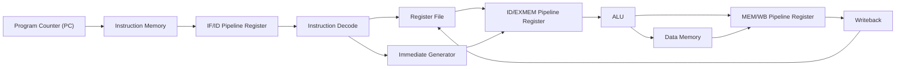
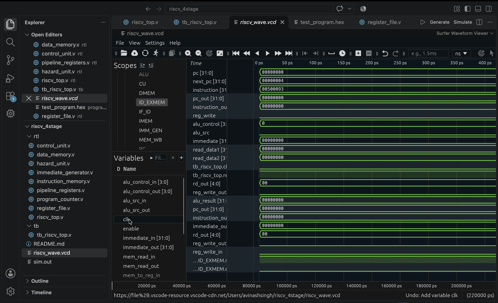

## Architecture

This project implements a 4-stage pipelined RISC-V processor in Verilog.



### Pipeline stages

1. **IF — Instruction Fetch:** PC selects an instruction from instruction memory.
2. **ID — Instruction Decode:** Decode instruction, read registers, generate immediate and control signals.
3. **EX/MEM — Execute and Memory:** ALU performs operations; data memory handles loads and stores.
4. **WB — Writeback:** Write ALU or memory result back to the register file.

### RTL Modules

| Module | Description |
|---|---|
| `program_counter.v` | Program counter |
| `instruction_memory.v` | Instruction storage |
| `register_file.v` | 32 × 32-bit register file |
| `immediate_generator.v` | RISC-V immediate extraction |
| `control_unit.v` | Instruction decode and control |
| `alu.v` | Arithmetic and logic operations |
| `data_memory.v` | Data memory |
| `pipeline_registers.v` | Pipeline stage registers |
| `riscv_top.v` | Processor top-level integration |

### Simulation

Run from the project root:

```bash
iverilog -g2012 -o sim.out rtl/*.v tb/tb_riscv_top.v
vvp sim.out
```

The testbench generates `riscv_wave.vcd`. Open it in a waveform viewer such as GTKWave or Surfer.

## Processor Architecture


## Simulation Waveform

The waveform below shows the basic ADDI instruction execution.



## Verification Results

The processor was simulated using Icarus Verilog, and the waveform was inspected using Surfer.

### Test Case: ADDI

- **Instruction:** `ADDI x1, x0, 5`
- **Instruction encoding:** `00500093`
- **Expected ALU result:** `5`
- **Observed ALU result:** `5`
- **Expected write-back data:** `5`
- **Observed write-back data:** `5`
- **Status:** Passed

The simulation waveform is available in [`docs/riscv_addi_writeback_waveform.png`](docs/riscv_addi_writeback_waveform.png).

## Verification

The processor was simulated using Icarus Verilog with a self-checking testbench.

### Test Results

| Test | Expected Result | Status |
|---|---:|---|
| `ADDI x1, x0, 5` | `x1 = 5` | PASS |
| `ADDI x2, x0, 3` | `x2 = 3` | PASS |

**Simulation result:** `ALL TESTS PASSED`

### Run Simulation

```bash
iverilog -g2012 -o sim.out rtl/*.v tb/tb_riscv_top.v
vvp sim.out
```

### Current Scope and Limitations

- Basic 4-stage pipeline: IF, ID, EX/MEM, WB
- Supports the instructions implemented in the current RTL
- Branch/jump control flow and hazard handling are not yet fully implemented
- Verification currently covers the listed test cases

