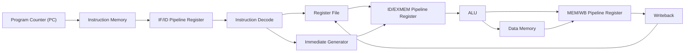
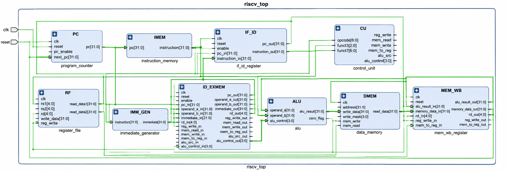
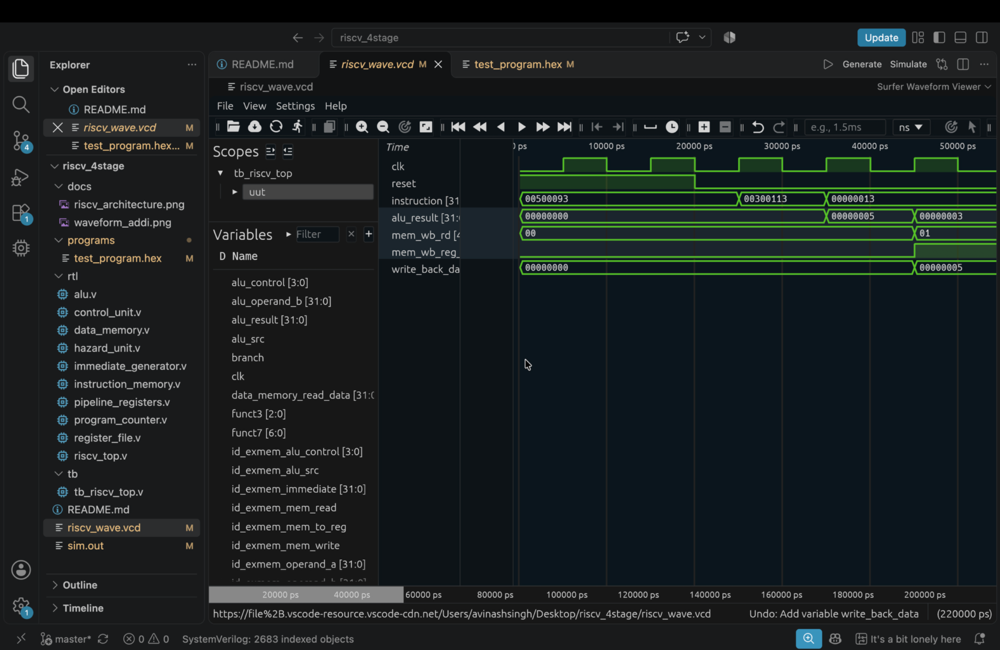

# RISC-V 32-bit 4-Stage Pipelined Processor

## Overview

This project implements a 32-bit RISC-V pipelined processor in Verilog. It uses a 4-stage pipeline to execute instructions, with the Execute and Memory operations combined into a single stage.

## Architecture



## Pipeline Stages

1. **IF — Instruction Fetch:** The program counter selects an instruction from instruction memory.
2. **ID — Instruction Decode:** The instruction is decoded; register operands, immediate values, and control signals are generated.
3. **EX/MEM — Execute and Memory:** The ALU performs arithmetic and logic operations, while data memory handles load and store instructions.
4. **WB — Writeback:** The ALU result or memory data is written back to the register file.

## Features

- 32-bit RISC-V datapath
- 4-stage pipelined architecture
- 32 general-purpose registers (x0–x31)
- Arithmetic and logic operations
- Load and store operations
- Branch instructions, including BGE
- Jump instructions: JAL and JALR
- Hazard detection and pipeline control
- Self-checking testbench

## RTL Modules

| Module | Description |
|---|---|
| `program_counter.v` | Program counter |
| `instruction_memory.v` | Instruction storage |
| `register_file.v` | 32 × 32-bit register file |
| `immediate_generator.v` | RISC-V immediate extraction |
| `control_unit.v` | Instruction decoding and control signals |
| `alu.v` | Arithmetic and logic operations |
| `data_memory.v` | Data memory |
| `pipeline_registers.v` | Pipeline stage registers |
| `hazard_unit.v` | Hazard detection and pipeline control |
| `riscv_top.v` | Processor top-level integration |

## Project Structure

```text
riscv_4stage/
├── rtl/                  # Processor RTL modules
├── tb/                   # Testbench files
├── programs/              # Hexadecimal test programs
├── docs/                 # Architecture and waveform screenshots
├── README.md
└── .gitignore
```

## Simulation

Run these commands from the project root:

```bash
iverilog -g2012 -o sim.out rtl/*.v tb/tb_riscv_top.v
vvp sim.out
```

The testbench generates `riscv_wave.vcd`. Open it using GTKWave:

```bash
gtkwave riscv_wave.vcd
```

## Verification Results

The processor was simulated using Icarus Verilog with a self-checking testbench.

| Test | Expected Result | Status |
|---|---|---|
| ADDI x1 | x1 = 5 | PASS |
| ADDI x2 | x2 = 3 | PASS |
| Arithmetic x3 | x3 = 7 | PASS |
| Dependent ADD x4 | x4 = 16 | PASS |
| Arithmetic x5 | x5 = 12 | PASS |
| BGE x6 | x6 = 13 | PASS |
| JAL link x7 | x7 = 72 | PASS |
| JAL target x8 | x8 = 21 | PASS |
| JALR base x9 | x9 = 100 | PASS |
| JALR link x10 | x10 = 92 | PASS |
| JALR target x11 | x11 = 31 | PASS |

**Regression result: ALL REGRESSION TESTS PASSED**

## Waveform Evidence

### Processor Architecture



### ADDI Writeback Waveform



Additional waveform screenshots are available in the `docs/` directory.

## Scope and Limitations

- Implements the instruction subset supported by the current RTL.
- Execute and Memory operations share one pipeline stage.
- Verification covers the test cases listed above; additional instruction and hazard testing can further improve coverage.
- No FPGA implementation or physical design results are included in this repository yet.

## Synthesis

The RTL was synthesized and checked using Yosys.

The synthesis report is available at
[`docs/synthesis_report.txt`](docs/synthesis_report.txt).

The report includes the synthesized hierarchy, cell statistics,
and structural checks.